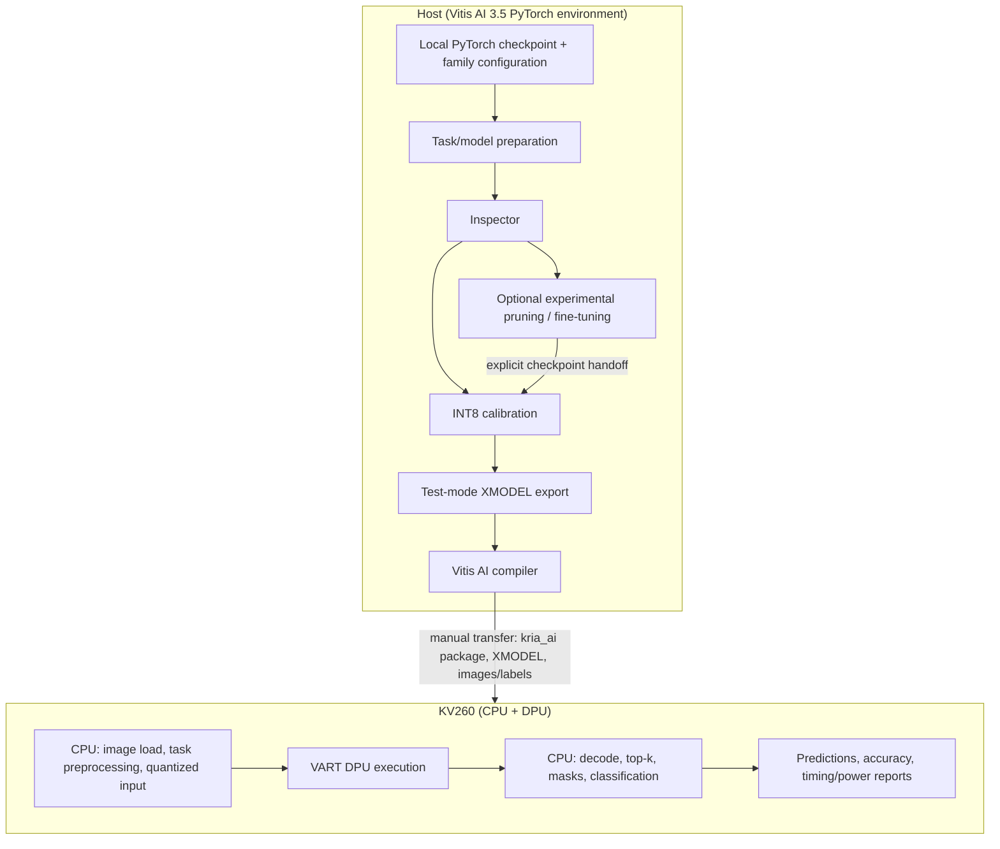

# Kria AI Framework

*PyTorch-to-KV260 deployment pipeline for image classification, YOLOv26 detection, and instance segmentation using Vitis AI 3.5.*

Deploying a PyTorch vision model on the Xilinx Kria KV260 requires adapting the graph to what the DPU supports, quantizing to INT8, compiling to an XMODEL, and driving board-side code that keeps CPU preprocessing, DPU submission, and post-processing aligned. This repository is an experimental systems framework that orchestrates that path end to end — from model inspection through measured on-board inference — for a specific, documented set of model families.

The project is organized around model families that own their task semantics (models, data, losses, post-processing) and a shared layer that owns Vitis AI stages, artifacts, and board runtime. Its current evidence base is a completed 5,000-image KV260 experiment on a two-class YOLO26n detector, reported below with its methodology and caveats.

[Architecture](docs/architecture.md) · [Experiments & Results](docs/experiments.md) · [Quick Start](#quick-start) · [Dataset Guide](DATASET_PREPARATION.md)

## Engineering Contributions

- **Shared deployment orchestration**: `python -m kria_ai` routes classification, detection, and segmentation through one consistent pipeline — inspect, optional optimize, quantize, compile, board benchmark — built on Vitis AI 3.5.
- **Family/task ownership**: each family module builds its own models, datasets, label parsing, and post-processing; `kria_ai/common/` supplies only the task-agnostic Vitis adapters, canonical artifact layout, board runtime, input quantization, power, and profiling.
- **Explicit contracts**: typed frozen-dataclass configs centralize model heads, class order, thresholds, and preprocessing metadata; YOLO head/output validation rejects incompatible checkpoints rather than decoding with wrong metadata.
- **DPU graph integration**: YOLO graphs are exported so the DPU emits raw one2one tensors; anchor-free decode, top-k selection, and mask assembly stay on the ARM CPU. For the FaceHuman detector, the project adapts the graph for the DPUCZDX8G with a LeakyReLU/ReLU split policy and a weight-equivalent C3k2 channel-split rewrite.
- **Bounded threaded execution with profiling**: board benchmarks use producer/consumer pipelines within the KV260's 1–4 runner limit and emit per-stage timing plus SOM power/energy reports.

Model architectures come from Ultralytics and torchvision; quantization, compilation, and the XIR/VART runtime come from AMD Vitis AI 3.5. The contribution here is the integration layer and its measurement methodology, not those upstream tools.

## Deployment Architecture



In prose: on the host, a local checkpoint and family configuration are prepared, inspected, optionally optimized (experimental; the result must be handed off explicitly — it is not selected automatically), calibrated to INT8, exported in test mode, and compiled. The compiled XMODEL, the `kria_ai` package, and test data are copied to the KV260 manually. On the board, the ARM CPU loads and preprocesses images, submits work to the DPU through VART, and performs decode/top-k/mask/classify post-processing, writing prediction, accuracy, and timing/power reports. There is no automatic optimization feedback loop.

Details: [docs/architecture.md](docs/architecture.md).

## Supported Scope

| Task / model CLI key | Dataset / input | Public status |
|---|---|---|
| `yolov26n_FaceHuman` (detection) | `openimagesv7`, 2 classes, 640x640 | Hardware-demonstrated reference configuration; one measured INT8 Fast Finetune artifact — not blanket production stability. |
| `resnet18`, `resnet50`, `mobilenet_v2`, `mobilenet_v3` (classification) | `intel_images`, 6 classes, 224x224 | Implemented deployment path; comparative hardware validation/results not supplied. |
| `yolov26s` (detection) | `coco`, 80 classes, 640x640 | Implemented; hardware validation pending and dataset-path caveat documented in the detection guide. |
| `yolov26n_seg` (instance segmentation) | `coco`, 80 classes, 640x640 | Experimental/WIP; CPU mask assembly implemented, validated benchmark absent. |
| Pruning / YOLO Fast Finetune | Family-specific | Experimental; one measured Fast Finetune artifact does not validate every model or optimizer path. |

YOLOv5 and semantic segmentation are outside the current architecture.

## Experimental Results

Accuracy is evaluated on the same held-out 5,000-image Open Images V7 test set (14,847 ground-truth boxes: 9,804 Person / 5,043 Human face) using two-class FaceHuman YOLO26n models with ordered classes `Person`, `Human face` and 640x640 input. GPU profiling covers 500 timed images after 50 warmups; FPGA profiling covers all 5,000 images with no warmup exclusion. The measured FPGA results come from experiment `full_test_20261021T092551Z_DPXti26q` (2026-10-21): the INT8 Fast Finetune `yolov26n_FaceHuman` XMODEL on a KV260 (configured DPU `DPUCZDX8G_ISA1_B4096` at 300 MHz). The GPU baseline is the corresponding unquantized FP32 checkpoint on an NVIDIA T4.

### Accuracy Comparison (YOLO26n)

| YOLO26n configuration | Fast Finetune | Precision (%) | Recall (%) | F1 (%) | mAP50 (%) | mAP50:95 (%) | Status |
|---|---|---:|---:|---:|---:|---:|---|
| GPU (T4), FP32 | Not applied | 40.87 | 57.15 | 47.66 | 43.92 | 30.73 | Measured |
| GPU, INT8 | Not specified yet | Pending | Pending | Pending | Pending | Pending | Pending |
| FPGA (KV260), INT8 | With, 1,000 images | 46.62 | 32.63 | 38.39 | 38.79 | 25.99 | Measured |
| FPGA (KV260), INT8 | Without | Pending | Pending | Pending | Pending | Pending | Pending |

For each measured configuration, precision/recall/F1 are reported at confidence 0.3 and matching IoU 0.5; mAP comes from a separate confidence-0.001 evaluation. **Pending** means no verified measurement exists — not zero. GPU F1 is the harmonic mean of macro precision and macro recall, matching the board evaluator's definition. The published GPU and FPGA results used different evaluators and detection heads, so this is a descriptive deployment comparison, not an isolated quantization-loss measurement.

The published FPGA accuracy values were produced by the project’s legacy scorer (confidence-ordered class-aware matching with mean 101-point AP); the GPU values use Ultralytics 8.4.150. All numbers remain unchanged. Current board `--accuracy` uses `ultralytics-8.4.150-numpy-v1`; fresh FPGA accuracy runs at confidence 0.3 and 0.001 are needed before replacing the legacy FPGA rows (see [docs/experiments.md](docs/experiments.md#current-detection-evaluator)).

Fast Finetune is the ablation between the two FPGA rows — both are INT8 quantization-calibrated; "Without" is not uncalibrated. The 1,000 Fast Finetune images are user-confirmed metadata (2026-10-22), not a count verified from the export.

### Profiling Comparison (YOLO26n)

Mean per-sample timing by broad stage role. `1 / 1` and `2 / 2` are DPU runners / producers — both FPGA runs use DPU batch 1 and the same measured Fast Finetune artifact; the GPU column is FP32 batch 1.

| Stage role (mean ms/image) | T4 FP32, batch 1 | KV260 INT8, 1 / 1 | KV260 INT8, 2 / 2 |
|---|---:|---:|---:|
| Image read / decode | 7.567 | 34.244 | 36.362 |
| Preprocessing | 1.902 | 11.544 | 18.817 |
| Model / accelerator execution | 11.550 | 12.254 | 14.082 |
| Postprocessing | 1.131 | 6.522 | 8.214 |
| End-to-end excluding disk I/O | 15.510 | Not measured | Not measured |
| End-to-end including disk I/O | 23.077 | Not measured | Not measured |

Interpretation:

- CPU/data-path work matters on KV260: in the 1/1 run, image reading averages 34.24 ms and preprocessing 11.54 ms, compared with 12.25 ms for VART submit/wait. Image I/O and CPU stages are optimization candidates; these overlapping timers do not establish exclusive bottleneck shares.
- The 2/2 pipeline reaches 35.83 FPS versus 21.69 FPS for 1/1, even though mean VART submit/wait rises from 12.25 to 14.08 ms. Pipeline concurrency improves observed throughput; it does not make an individual DPU call faster.
- T4 FP32 batch-1 inference and KV260 submit/wait have means of 11.55 ms and 12.25/14.08 ms respectively, but cover different graph/runtime boundaries. Do not interpret similar means as equivalent hardware execution.
- FPGA per-image end-to-end latency was not measured. Neither a sum of overlapping means nor reciprocal application FPS reconstructs it.

These are descriptive stage-role comparisons, not identical timing boundaries or isolated hardware/quantization effects: GPU is FP32 timed over 500 images after 50 warmups, FPGA is INT8 over all 5,000 images with no warmup exclusion; the heads differ (GPU one2many+NMS vs raw one2one/top-k) and power scopes differ (GPU-only vs SOM-total). GPU INT8 results are not yet available. Full stage inventory, percentiles, and caveats: [docs/experiments.md](docs/experiments.md#gpufpga-comparison-matched-test-set).

### KV260 Throughput And Energy

Performance source runs `performance_t1_p1_conf030` and `performance_t2_p2_conf030` — confidence threshold 0.3, queue size 40, accuracy/drawing/saving disabled, profiling enabled, 5,000 DPU jobs each, runtime power sampling, no warmup exclusion:

| DPU runners / producers | Application FPS | Mean VART submit/wait (ms/image) | SOM-total power (W) | Energy (mJ/image) |
|---|---:|---:|---:|---:|
| 1 / 1 | 21.69 | 12.25 | 6.62 | 305.19 |
| 2 / 2 | 35.83 | 14.08 | 6.98 | 194.69 |

**Caveats.**

- Application FPS includes image loading, worker startup, and pipeline drain, but excludes model/OpenCV initialization.
- VART latency is mean `execute_async` + wait — not end-to-end latency, pure DPU kernel time, or reciprocal throughput.
- Power is SOM-total (not carrier-board/wall power and not DPU-only); energy/image is sampled average power divided by application FPS.
- Single sequential passes only — no repeated-run means or confidence intervals; caches and thermal conditions were not reset and thermal telemetry is absent.
- The published KV260 accuracy came from a custom class-aware greedy evaluator (IoU 0.5 matching for P/R; 101-recall-level AP at IoU 0.50:0.05:0.95; F1 = harmonic mean of macro P/R) — the historical legacy scorer, not the official COCO or Ultralytics evaluator and not the current NumPy scorer.
- Profiling stages overlap across threads, so `wall_pct` can exceed 100% and is not hardware utilization.

Methodology and evidence: [docs/experiments.md](docs/experiments.md). Frozen evidence excerpts: [KV260 evidence](docs/evidence/kv260-facehuman-2026-10-21.json), [T4 context](docs/evidence/t4-facehuman-context.json).

## Quick Start

Prerequisites:

- Working directory is the repository root.
- Host stages run inside the Vitis AI 3.5 PyTorch environment.
- A compatible Ultralytics source checkout at `models/ultralytics-main` (user-supplied; no public download recipe is provided).
- A trained two-class checkpoint; the configured default is `models/yolov26n_2classes.pt`, and `--checkpoint` may be supplied consistently to inspect and both quantize stages.
- Calibration images at `data/openimagesv7/train/images` — YOLO calibration and Fast Finetune are image-only and do not read labels. Labeled evaluation dataset paths are listed in the [dataset guide](DATASET_PREPARATION.md).
- A separately provisioned KV260 with compatible DPU firmware plus the XIR/VART runtime, NumPy, and OpenCV.

This repository has no independently verified packaging or environment lock: there is no `pip install`, model download, or universal container command.

A small host workflow for the measured model (an example workflow that has been parser/static-checked — local asset gaps mean it was not executed end-to-end here, and it is not an exact reconstruction of the historical calibration recipe):

```bash
python -m kria_ai yolov26 detection inspect \
  --model yolov26n_FaceHuman --build-root build_fast_ft
python -m kria_ai yolov26 detection quantize \
  --model yolov26n_FaceHuman --dataset openimagesv7 --mode calib \
  --subset-len 100 --batch-size 4 --seed 42 --fast-ft --build-root build_fast_ft
python -m kria_ai yolov26 detection quantize \
  --model yolov26n_FaceHuman --dataset openimagesv7 --mode test \
  --fast-ft --build-root build_fast_ft
python -m kria_ai yolov26 detection compile \
  --model yolov26n_FaceHuman --build-root build_fast_ft
```

`--fast-ft` is experimental and must appear in both the calibration and test/export commands when used. Keep one `--build-root` per pipeline run: stages write artifacts, so choose a fresh build root to preserve an existing run. Quantizer `test` mode performs a one-image forward/export — it is not a test-set accuracy run.

Transfer to the board is manual: copy the `kria_ai/` package, the compiled `yolov26n_facehuman_kria.xmodel` (from `build_fast_ft/yolov26n_facehuman/compiled/`), and test images/labels. Board inference needs no PyTorch checkpoints or Ultralytics source. From a directory containing the package and XMODEL, with data at `datasets/openimagesv7/fpga_test_images/{images/test,labels/test}`:

```bash
python3 -m kria_ai yolov26 detection benchmark \
  --model yolov26n_FaceHuman --dataset openimagesv7 \
  --xmodel yolov26n_facehuman_kria.xmodel \
  --dataset-root datasets/openimagesv7/fpga_test_images/images/test \
  --threads 2 --producers 2 --queue-size 40 --confidence-threshold 0.3 \
  --no-draw --no-save --profile --profile-json \
  --output-report reports/facehuman_performance_t2_p2.txt
```

`--dataset-root` points at one flat directory of images — it is not scanned recursively — so pass the `images/test` path explicitly. Do not confuse the three "evaluation" surfaces: host-side `evaluate` reports loss (not mAP), quantizer `test` mode performs a one-image forward/export, and board `--accuracy` is the mAP path.

For accuracy evaluation (`--accuracy --labels-dir ...`), the 1/1 variant, and classification/segmentation commands, see the [detection guide](scripts/detection/README.md), [classification guide](scripts/classification/README.md), and [segmentation guide](scripts/segmentation/README.md).

## Reproducibility And Documentation

- [docs/architecture.md](docs/architecture.md) — module map, CPU/DPU contracts, artifact layout, deployment boundary.
- [docs/experiments.md](docs/experiments.md) — measurement definitions, evidence provenance, T4 GPU context, validation matrix, planned experiments.
- [DATASET_PREPARATION.md](DATASET_PREPARATION.md) — dataset registries, label formats, board layout, known config caveats.
- Task guides: [classification](scripts/classification/README.md), [detection](scripts/detection/README.md), [segmentation](scripts/segmentation/README.md).

Dependency-light host validation (does not exercise Vitis AI stages or hardware):

```bash
python -B -m unittest discover -s tests -p test_family_configs.py -v
python -B -m unittest discover -s tests -p test_benchmark_cli.py -v
python -m kria_ai --help
```

These are the narrow contract checks; broader suite commands and their dependency requirements are listed in [docs/architecture.md](docs/architecture.md).

Full end-to-end validation requires the Vitis AI environment and a KV260; the recorded results above are historical board measurements, not a fresh rerun performed for this documentation.

**Limitations and next steps.** Current limits: the measured result covers one model, one dataset, one quantization path, and single-pass runs, with operating-point and AP evaluations reported separately. Next research steps include controlled FP32/INT8 comparisons with the same head and evaluator, repeated thermal- and cache-aware trials, baseline-vs-Fast-Finetune ablation, pruning trade-off studies, and cross-task hardware validation. See [docs/experiments.md](docs/experiments.md#planned-experiments) for the full list.

**Acknowledgements.** Built on [Ultralytics](https://github.com/ultralytics/ultralytics) model implementations, torchvision models, and the AMD Vitis AI 3.5 toolchain (PyTorch quantizer, compiler, XIR/VART runtime).
